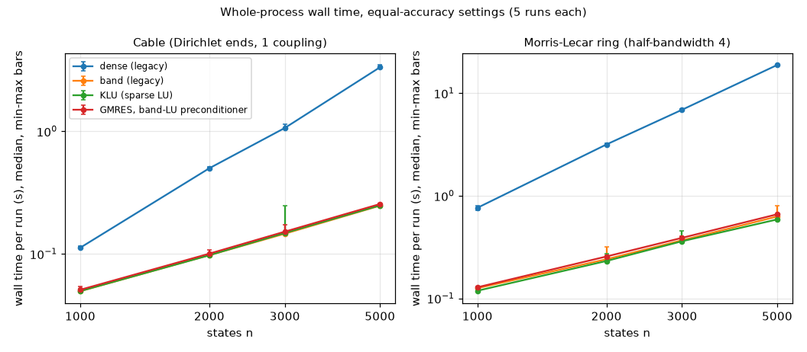
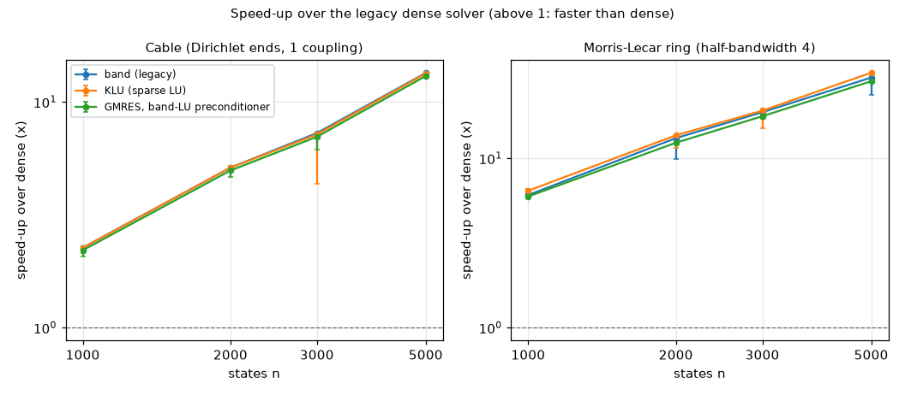
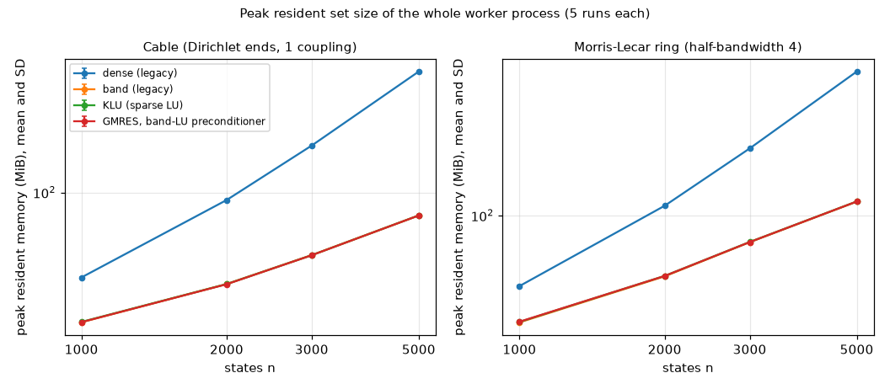

# W378: large stiff networks, stages 1 and 2 (#440)

Stage 2's timed series ran on the Ubuntu comparison machine; its results and the decision are in
[Results](#results) and [Recommendation](#recommendation) below.
This card changes no production code or user-facing behaviour; it adds only docs and
`tools/studies/w378_plots.py`, which writes the plots and tables. The study
kit is `paper/benchmarks/large-stiff/`, deliberately git-ignored like the
rest of the paper; the coordinator must copy that directory separately.

The study compares the existing CVODE dense and banded solvers with
SUNDIALS 7.9.0 CVODE/KLU and left-preconditioned restarted GMRES. Both
families use 1000, 2000, 3000 and 5000 states. Only 50 and 200 states were
run here, without timing. The large sizes were measured in stage 2 (see Results).

The standalone adapter loads the model through `xpp::load_model`, calls
`my_rhs` for every engine and reads the compiled sparse derivative
program produced by `core/expr_derivative.cpp`. There is no second
equation translator. The unchanged core is linked privately in a shared
library to isolate its old CVODE C ABI from SUNDIALS' incompatible ABI.
Study-only hooks instrument actual LU setup functions only when the
stage-2 command explicitly enables measurement. Instrumented factorization
diagnostics run separately from the headline time/RSS repeats.

The cable has Dirichlet ends and diffusion coefficient `(n+1)^2`, a unit
interval refinement. The Morris-Lecar ring reuses size-scaling's lecdiff
conductances, with capacitance 0.001. Its cell order is folded
`0,1,m-1,2,m-2,...`, with voltage and gate interleaved. This keeps both
wraparound edges inside half-bandwidth 4; no corner is dropped. GMRES
uses an exact band LU of `I-gamma*J` as its left preconditioner. This is a
strong baseline for these banded networks, not a general sparse-network
preconditioner. The legacy rows retain their native difference Jacobian;
KLU, reference and GMRES preconditioner use the exact sparse program.

Dependencies for the maintainer (nothing installed by the card):

```sh
sudo apt install build-essential cmake libsuitesparse-dev time valgrind
```

Use SUNDIALS **7.9.0**, configured as in W34 with static double-precision
CVODE, serial vectors, sparse/band matrices, band/KLU/SPGMR solvers and
`-ffp-contract=off`; the kit README has the complete configuration.
`tools/comparison-setup.sh` is unchanged: these dependencies belong to
this study until another card needs them.

## Stage-1 evidence (2026-10-18, WSL, untimed)

Every generated model loaded through the unchanged core. Compiled and
interpreted initial RHS agree exactly (relative difference 0 in all four
cases); all engines call this same RHS function. Exact-Jacobian patterns
have 148/598 nonzeros for cable n=50/200, half-bandwidth 1; 150/600 for
ring n=50/200, half-bandwidth 4. Both ring corners remain inside the band.

Errors are max `abs(y-reference)/(1+abs(reference))` over every state and
101 common output times; endpoint uses the last row. The study writes
double precision, avoiding W34's production output.dat precision floor.
Reference is SUNDIALS band/exact at 5e-10, checked against 1e-9.

| Model | Reference halving difference, along run | Final time |
|---|---:|---:|
| Cable 50 | 5.20e-9 | 0.2 |
| Cable 200 | 5.29e-9 | 0.2 |
| Ring 50 | 2.53e-8 | 2 |
| Ring 200 | 3.92e-7 | 2 |

The reference limit is 1e-6, 100 times below the common accuracy target
1e-4. These are sampled trajectory convergence checks, not a proof of
a uniform error bound between output times.

| Model | Solver | rtol = atol | Error along run | Endpoint error |
|---|---|---:|---:|---:|
| Cable 50 | Legacy dense and band, each | 1e-5 | 3.44e-5 | 1.51e-5 |
| Cable 50 | GMRES, exact band LU preconditioner | 1e-5 | 3.25e-5 | 1.44e-5 |
| Cable 200 | Legacy dense and band, each | 1e-5 | 2.87e-5 | 1.02e-5 |
| Cable 200 | GMRES, exact band LU preconditioner | 1e-5 | 2.33e-5 | 7.92e-6 |
| Ring 50 | Legacy dense and band, each | 1e-7 | 1.81e-5 | 5.94e-6 |
| Ring 50 | GMRES, exact band LU preconditioner | 1e-6 | 2.94e-5 | 1.01e-5 |
| Ring 200 | Legacy dense and band, each | 1e-7 | 1.22e-5 | 2.91e-6 |
| Ring 200 | GMRES, exact band LU preconditioner | 1e-6 | 5.53e-5 | 1.20e-5 |

All 12 solver/workload rows pass. The loose pilot uses 1e-5 with an
unchanged 3e-3 agreement limit. An earlier 1e-4 pilot failed on ring 200:
legacy dense error 0.00574684 along the run, 0.000447763 at the endpoint.
That negative result is retained; no error limit was widened. Each
solver then tightens its own tolerance by factors of ten until it meets
the common accuracy target. Equal tolerances do not imply equal accuracy.

**KLU remains unvalidated locally:** SuiteSparse is absent. Stage 1
records this omission; stage 2 refuses to run without KLU. Review added
short n=200 one-shot planning probes, actual factor-timer smoke checks
and two capped cache profiles. No speed or memory saving against another
solver is established by these planning observations; n=5000 remains
unrun locally. Stage 2 ran KLU on Ubuntu (see Results).

Gates: both study adapters built with `-Werror`; the application build
and all 58 unit-test executables passed; five Python scripts passed
`py_compile`; four synthetic protocol tests passed (rotation and fresh
runs, failure retention, GNU time parsing, cache misses per factor).
Two actual cache smoke profiles stop at exactly three DenseFactor calls.
No verify.sh, full
web2check, sanitizer suite, timing series or large model run was started.
Gates ran on WSL ext4 under the prescribed heavy slot.

The ignored kit's `stage1-results/` contains trajectories, solver counts,
source/input hashes, logs and correctness.json, including the failed
loose-pilot log. Copy these with the kit. Original absolute WSL paths
identify where the runs took place; they are not portable commands.
The current review's rerun and planning evidence are in
`stage1-review-results/`; the original evidence and failed pilot remain.

## Running stage 2

The [kit README](../../paper/benchmarks/large-stiff/README.md) has the full
pinned SUNDIALS configuration and commands. Additional dependencies are
listed above; SUNDIALS 7.9.0's switches are
`-DSUNDIALS_ENABLE_KLU=ON -DSUNDIALS_ENABLE_SUNLINSOL_KLU=ON`
and `-DKLU_INCLUDE_DIR=/usr/include/suitesparse`. Nothing was installed.

From the Ubuntu clone's root, after copying the kit and following
docs/comparison-machine.md:

```sh
KIT=paper/benchmarks/large-stiff
python3 "$KIT/build.py" --sundials "$HOME/w378-deps/sundials-install" --out build/w378
python3 "$KIT/study.py" check --worker build/w378/worker --sizes 50 200 --out build/w378/check-ubuntu
python3 "$KIT/study.py" check --worker build/w378/worker --sizes 1000 2000 3000 5000 --out build/w378/pilot-ubuntu
tools/comparison-setup.sh --record
# MACHINE is the exact JSON path printed above; governor performance, fixed turbo.
tools/comparison-setup.sh --ready
python3 "$KIT/study.py" measure --worker build/w378/worker --cpu 2 --pilot build/w378/pilot-ubuntu --machine-record "$MACHINE" --out build/w378/results-w354-ubuntu
python3 "$KIT/study.py" cache --worker build/w378/worker --cpu 2 --out build/w378/results-w354-ubuntu
python3 "$KIT/study.py" summarize --out build/w378/results-w354-ubuntu
```

The measurement and cache commands each call `--ready`. Five measured
fresh processes follow one excluded warm-up per engine/workload, in
rotating order, one thread pinned to CPU 2. Fresh HOME/config, LC_ALL=C,
machine record, source/input/binary hashes, individual runs and failures
are retained. Summaries use mean/sample SD; GNU time gives peak RSS,
with unrounded parent wall/child CPU clocks retained too. The same dense
workload checks drift at the start and end. Direct solves have no Krylov
iteration count (explicit null); setup and Newton counts are saved.
GMRES saves iterations and preconditioner solves.

Native time/RSS cover the entire worker process, including load, model
compilation and output. Factor diagnostics wrap legacy DenseFactor and
BandFactor; SUNDIALS uses its solver's `ops->setup` callback to instrument
SUNLinSolSetup_Band/KLU (linker wrapping cannot intercept addresses
resolved inside the same library object). KLU's first setup includes
symbolic analysis. The short band/GMRES/reference probes now exercise
those callbacks and retain each factor's time; KLU awaits Ubuntu.

### Bounded cache diagnostic

At the largest n (5000), each family's cache process collects **three
DenseFactor calls**, then ends immediately: six calls total, not a full
integration. Startup/load instrumentation is off (`--instr-atstart=no`);
a client request starts it at the first linear setup, and
`--toggle-collect=DenseFactor` collects only LU and descendants. A
per-run counter stops instrumentation at setup three and unwinds the
owned C++ CVODE state. A failed setup aborts without more attempts.
Each legacy dense setup makes one DenseFactor call; both actual n=200
profiles independently record `calls=3` at that function.

The truncated trajectory is marked as a cache diagnostic, not accepted
as a normal integration. `cache-summary.json` reports all event totals
and I1, D1 read/write, and last-level read/write **misses per
factorization**, divided by the verified count of three. It uses
callgrind's `totals:` record: `summary:` may be zero after instrumentation
is stopped. Cache state is not flushed between the three calls. Keep
raw profiles and cache geometry. This tests the existing storage's
locality; no alternative LU layout is implemented.

### Planning estimate after review

Reserve **30–125 minutes** for stage 2 on a comparable or faster Ubuntu
CPU, excluding dependencies/build and W354's other studies. `measure`
dominates the central estimate. These are extrapolated planning ranges,
not measured Ubuntu results or speed comparisons; manual readiness waits
are separate. The kit's review estimates.json retains the arithmetic:

| Step | Central model | Planning range |
|---|---:|---:|
| Small `check`, n=50/200 | seconds | 0.25–1 min |
| Full-ladder pilot and tolerance selection | 12 min | 6–25 min |
| `measure`, including warm-up, diagnostics and drift | 32 min | 15–65 min |
| `cache`, 3 LU calls per family | 14 min | 7–30 min |

The single-run n=200 wall observations were cable/ring: dense
0.077507/0.158355 s, band 0.070232/0.105320 s, GMRES
0.070002/0.103289 s, reference 0.072175/0.112546 s. Actual dense
factor totals were 0.0014833/0.0098649 s across 13/69 calls.
With q=n/200, use `(T200-F200)*q+F200*q^3` for dense, separating
launch/model/output from the generic cubic factor work, and `T200*q`
for band/KLU and the strongly preconditioned GMRES/reference. KLU's
planning proxy is band time, not a measurement. Sum(q)=55 and
sum(q^3)=20125 on the four-size ladder. The README gives candidate
tolerance counts and all arithmetic; pilot and iteration assumptions
are explicit. There are 160 measured processes, 32 warm-ups, 32 factor
diagnostics and two drift probes, plus calibration/references.

The n=200 three-call cache regions took 0.515008/0.692936 s; whole
processes took 1.537973/2.036661 s. For these fixed-band inputs,
core/dense.cpp skips zero pivot-row updates (`a_kj != 0`), so its actual
sampled work is quadratic with bounded fill, below the generic dense
cubic upper model. Extrapolate the profiled region by 625=(5000/200)^2
and the remaining startup/load by 25: 814 s (13.6 min) for both
families. Allowing roughly half to twice the model and startup variation
gives 7–30 min, well below an hour. The fixed call count bounds work;
there is no speed-based correctness gate or full-trajectory callgrind run.
Different iteration counts, fill, tolerance refinements or CPU/cache
costs require updating the estimate from the Ubuntu pilot. No repeat
timing series or large-size run was made on the laptop.

## Reuse and limits

Searched W34's adapter, build switch, evaluation/report scripts and study;
size-scaling's generator; ModelDB's C translator; the core RHS and exact
derivative/Jacobian owners; comparison-setup's machine/readiness logic.
Reused their settings, error metric, model conductances and existing APIs.
The simpler hand-written RHS was rejected because the shared core bridge
ensures equation, compiler and math-function parity. No translator is
duplicated. The bridge is not a proposed production architecture.

Commands use argv arrays; artifact directories are fresh, with no shell
composed from model input or recursive deletion. The existing bounded
loader validates models. Artifact paths and the kit are trusted local
study inputs. No production trust boundary changed. No temporary files
or own background runs remain; the existing coordinator agent-register
entry belongs to the coordinator.

## Results

Stage 2 ran on the Ubuntu comparison machine. It is an Intel Core i7-11700F (8 cores, SMT on, 16 threads), Ubuntu 26.04, governor `performance`, turbo on, 32 GB, gcc 15.2. The source is xppautX commit b479d256, an ancestor of this branch, built with SUNDIALS 7.9.0 including KLU. The raw folder is `~/xppautx-comparison/final/large-stiff/attempt-001/` (not in git). Its `results/` holds `runs.json`, `summary.json` and `summary.csv`, `crossings.json`, `drift.json`, `cache-summary.json`, `factors/`, `cache/`, `machine.json` and `provenance.json`. The tables below and the plots are generated from those files by `uv run --locked python tools/studies/w378_plots.py --tables`.

### Answers to the four quantities

| Quantity | Cable | Morris-Lecar ring |
|---|---|---|
| Equal-accuracy time break-even n | Below 1000. Band, KLU and GMRES are faster than dense at every measured size (1000, 2000, 3000, 5000); the crossing itself was not timed. Band is 2.26x at 1000 | Below 1000. Band is 6.07x at 1000 |
| Peak-memory break-even n | Below 1000. At 1000, band uses 20.3 MiB and dense 35.2 MiB | Below 1000. At 1000, band uses 30.4 MiB and dense 45.5 MiB |
| Dense LU cache simulation at n=5000, per factorization | 1.74e7 D1 read misses, 3.13e6 last-level read misses, 6.10e8 instructions. The last-level misses match the 3.125e6 cache lines of the 200 MB matrix (5000 x 5000 x 8 bytes / 64 bytes), consistent with the whole matrix streaming from memory once per factorization | 1.92e7 D1 read misses, 3.13e6 last-level read misses, 6.40e8 instructions; the same matrix-sized streaming |
| Recommendation: verbatim vendor or no adoption | No vendoring now; the maintainer decides (Recommendation below) | The same |

### Run record

- 192 timed processes: 8 workloads (cable and ring at 1000, 2000, 3000 and 5000 states) x 4 methods. Each row has one excluded warm-up and five measured fresh processes, 160 measured in all. All 192 exited with status 0, and every run passed the accuracy check (along-run error at most 1e-4). Nothing failed, and no row is missing: each of the 32 rows holds five measured runs.
- 32 factorization-diagnostic processes, one per row (`factors/`). Every factorization reported success. Their counts appear in the factorization table.
- Two dense calibration runs (cable 1000) at the start and end of the series (`drift/`).
- Two cache profiles at n=5000 (cable and ring). Each stopped after exactly three DenseFactor calls, and `cache-summary.json` records them as the kit requires.
- Missing or unclear: `attempt-001.log` holds only the pilot checks and the readiness waits. It has no completion line for the measure, cache or summary steps. Their completion is shown by the output files listed above, all present (`runs.json` has 192 entries, `summary.json` 32 rows, `cache-summary.json` two). The readiness lines in the log show a process named `localsearch-3` at 17 to 100% CPU before the final `ready:` line.

### Caveats and deviations from the plan

Read these before comparing rows.

1. **CPU.** The kit's README pins to CPU 2. The measured runs were pinned to CPU 0 (`command.json`: `taskset -c 0`; `provenance.json`: cpu 0). CPU 0's SMT sibling is CPU 8 (`machine.json`). Nothing else differs from the README.
2. **Tolerance per row.** The pilot chose a tolerance per method and workload. For cable, every method used 1e-5. For the ring, every method used 1e-6 at 1000 and 3000 states. At 2000 and 5000, dense, band and KLU used 1e-7 and GMRES used 1e-6. `pilot/correctness.json` keeps only the chosen tolerances, not the rejected ones, so the reason for the ring split cannot be checked from the data. Its effect: the ring GMRES rows at 2000 and 5000 are less accurate (along-run error 8.6e-5 and 8.7e-5, against 4.0e-7 and 2.1e-5 for the direct solvers) and take fewer steps (249, against 356 and 353). Those two rows are not equal-accuracy comparisons. The looser tolerance favours GMRES, so at matched accuracy its gap to band would likely be larger than shown.
3. **Jacobian source.** Dense and band use the legacy solver's own difference Jacobian. KLU and GMRES use the exact sparse derivative program of the kit. The right-hand-side counts show the difference: dense makes 2085 to 10089 calls for cable and 9632 to 40501 for the ring, growing with n; band makes 91 to 95 (cable) and 573 to 713 (ring); KLU makes 85 to 89 (cable) and 501 to 568 (ring); GMRES makes 90 (cable) and 364 to 365 (ring). The KLU-to-band comparison is therefore not Jacobian-matched. This follows from the legacy solvers, not from an error.
4. **Drift.** The dense calibration on cable 1000 took 0.1144 s at the start and 0.1334 s at the end, a change of +16.6% (`drift.json`). The end value is above all five measured runs of that row (0.1113 to 0.1153 s). Something slowed the machine during the series. Turbo and temperature are likely, but neither was recorded. The ring rows ran later in the series, so they are the more exposed. No correction was applied.
5. **Noise.** Readiness was checked once before the series, not between runs. Some single runs sit well above their row's median: cable 3000 KLU (0.2455 s against a median of 0.148 s, +66%), ring 2000 band (0.318 s, +32%), ring 3000 KLU (0.457 s, +27%) and ring 5000 band (0.795 s, +27%). Those rows have large spreads (coefficient of variation 25% for cable 3000 KLU, 12% for ring 5000 band). The medians are robust to one such run in five. Treat the spread as noise, not as a property of the solver.
6. **What the wall time measures.** Each wall time is the whole worker process, covering model load and compilation, the integration and the output. The factorization is a small part of the wall time for band, KLU and GMRES (0.3% to 1.4%, from the separate factorization runs), and 17% to 36% for dense. The forward and back solves, right-hand-side work and Newton work are not timed separately, so the data cannot show how much of band's wall time is the solve itself. No run measured the fixed cost (load, compilation, output) alone. The smallest measured process, band at cable 1000, uses 20.3 MiB.
7. **Cache.** The cache profile covers one size (5000) and three factorizations per family. It is not a whole integration, and it measures only the locality of the existing dense storage.

### Tables

The tables are generated by `tools/studies/w378_plots.py --tables`. Wall times are medians of five runs with the sample SD and the min-max range. Counts are identical across the five repetitions of a row, so one value is shown.

#### Timing (median of 5, sample SD, min-max, speed-up over dense)

| family | n | method | runs | median s | SD s | min-max s | speed-up vs dense |
|---|---|---|---|---|---|---|---|
| cable | 1000 | dense (legacy) | 5 + 1 warm-up | 0.1122 | 0.00171 | 0.1113-0.1153 | 1x |
| cable | 1000 | band (legacy) | 5 + 1 warm-up | 0.04963 | 0.0007852 | 0.04889-0.05077 | 2.26x |
| cable | 1000 | KLU (sparse LU) | 5 + 1 warm-up | 0.04973 | 0.001229 | 0.04931-0.05228 | 2.26x |
| cable | 1000 | GMRES, band-LU preconditioner | 5 + 1 warm-up | 0.05095 | 0.00155 | 0.05041-0.05424 | 2.2x |
| cable | 2000 | dense (legacy) | 5 + 1 warm-up | 0.4991 | 0.006216 | 0.4966-0.5105 | 1x |
| cable | 2000 | band (legacy) | 5 + 1 warm-up | 0.09756 | 0.00114 | 0.09581-0.09848 | 5.12x |
| cable | 2000 | KLU (sparse LU) | 5 + 1 warm-up | 0.0975 | 0.0002113 | 0.09742-0.09792 | 5.12x |
| cable | 2000 | GMRES, band-LU preconditioner | 5 + 1 warm-up | 0.1004 | 0.003251 | 0.09933-0.1075 | 4.97x |
| cable | 3000 | dense (legacy) | 5 + 1 warm-up | 1.064 | 0.03625 | 1.063-1.145 | 1x |
| cable | 3000 | band (legacy) | 5 + 1 warm-up | 0.1461 | 0.0009625 | 0.1457-0.148 | 7.28x |
| cable | 3000 | KLU (sparse LU) | 5 + 1 warm-up | 0.1481 | 0.04251 | 0.1468-0.2455 | 7.19x |
| cable | 3000 | GMRES, band-LU preconditioner | 5 + 1 warm-up | 0.1518 | 0.009683 | 0.1509-0.1731 | 7.01x |
| cable | 5000 | dense (legacy) | 5 + 1 warm-up | 3.324 | 0.09205 | 3.28-3.486 | 1x |
| cable | 5000 | band (legacy) | 5 + 1 warm-up | 0.2471 | 0.001489 | 0.2464-0.2501 | 13.4x |
| cable | 5000 | KLU (sparse LU) | 5 + 1 warm-up | 0.2485 | 0.001555 | 0.2476-0.2516 | 13.4x |
| cable | 5000 | GMRES, band-LU preconditioner | 5 + 1 warm-up | 0.255 | 0.001571 | 0.2534-0.2576 | 13x |
| ring | 1000 | dense (legacy) | 5 + 1 warm-up | 0.7628 | 0.02595 | 0.726-0.7977 | 1x |
| ring | 1000 | band (legacy) | 5 + 1 warm-up | 0.1257 | 0.0009841 | 0.1245-0.1267 | 6.07x |
| ring | 1000 | KLU (sparse LU) | 5 + 1 warm-up | 0.1185 | 0.00226 | 0.1153-0.1207 | 6.44x |
| ring | 1000 | GMRES, band-LU preconditioner | 5 + 1 warm-up | 0.1281 | 0.002093 | 0.1255-0.1313 | 5.95x |
| ring | 2000 | dense (legacy) | 5 + 1 warm-up | 3.163 | 0.06663 | 3.087-3.242 | 1x |
| ring | 2000 | band (legacy) | 5 + 1 warm-up | 0.2403 | 0.03471 | 0.2351-0.3179 | 13.2x |
| ring | 2000 | KLU (sparse LU) | 5 + 1 warm-up | 0.2312 | 0.01947 | 0.2293-0.2743 | 13.7x |
| ring | 2000 | GMRES, band-LU preconditioner | 5 + 1 warm-up | 0.2558 | 0.004349 | 0.253-0.262 | 12.4x |
| ring | 3000 | dense (legacy) | 5 + 1 warm-up | 6.887 | 0.05731 | 6.838-6.994 | 1x |
| ring | 3000 | band (legacy) | 5 + 1 warm-up | 0.3677 | 0.004666 | 0.3658-0.3777 | 18.7x |
| ring | 3000 | KLU (sparse LU) | 5 + 1 warm-up | 0.3601 | 0.0443 | 0.3499-0.4565 | 19.1x |
| ring | 3000 | GMRES, band-LU preconditioner | 5 + 1 warm-up | 0.3886 | 0.007559 | 0.3859-0.4043 | 17.7x |
| ring | 5000 | dense (legacy) | 5 + 1 warm-up | 18.82 | 0.06576 | 18.77-18.93 | 1x |
| ring | 5000 | band (legacy) | 5 + 1 warm-up | 0.6277 | 0.07672 | 0.6171-0.7946 | 30x |
| ring | 5000 | KLU (sparse LU) | 5 + 1 warm-up | 0.5874 | 0.001014 | 0.5868-0.5894 | 32x |
| ring | 5000 | GMRES, band-LU preconditioner | 5 + 1 warm-up | 0.6595 | 0.004164 | 0.6524-0.6636 | 28.5x |

#### Accuracy and counts (worst of 5 runs; counts are identical across repetitions)

| family | n | method | rtol=atol | error along | error endpoint | steps | rhs calls | Newton | Jacobians | setups | Krylov iterations | preconditioner solves | factorizations (own run) |
|---|---|---|---|---|---|---|---|---|---|---|---|---|---|
| cable | 1000 | dense (legacy) | 1e-05 | 2.85e-05 | 1e-05 | 67 | 2085 | 82 | 2 | 13 | - | - | 13 |
| cable | 1000 | band (legacy) | 1e-05 | 2.85e-05 | 1e-05 | 67 | 91 | 82 | 2 | 13 | - | - | 13 |
| cable | 1000 | KLU (sparse LU) | 1e-05 | 2.85e-05 | 1e-05 | 67 | 85 | 82 | 2 | 13 | 0 | 0 | 13 |
| cable | 1000 | GMRES, band-LU preconditioner | 1e-05 | 2.4e-05 | 8.05e-06 | 73 | 90 | 87 | 13 | 13 | 73 | 146 | 13 |
| cable | 2000 | dense (legacy) | 1e-05 | 2.85e-05 | 1e-05 | 67 | 4085 | 82 | 2 | 13 | - | - | 13 |
| cable | 2000 | band (legacy) | 1e-05 | 2.85e-05 | 1e-05 | 67 | 91 | 82 | 2 | 13 | - | - | 13 |
| cable | 2000 | KLU (sparse LU) | 1e-05 | 2.85e-05 | 1e-05 | 67 | 85 | 82 | 2 | 13 | 0 | 0 | 13 |
| cable | 2000 | GMRES, band-LU preconditioner | 1e-05 | 2.4e-05 | 8.05e-06 | 73 | 90 | 87 | 13 | 13 | 73 | 146 | 13 |
| cable | 3000 | dense (legacy) | 1e-05 | 2.84e-05 | 9.98e-06 | 67 | 6085 | 82 | 2 | 13 | - | - | 13 |
| cable | 3000 | band (legacy) | 1e-05 | 2.84e-05 | 9.98e-06 | 67 | 91 | 82 | 2 | 13 | - | - | 13 |
| cable | 3000 | KLU (sparse LU) | 1e-05 | 2.84e-05 | 9.98e-06 | 67 | 85 | 82 | 2 | 13 | 0 | 0 | 13 |
| cable | 3000 | GMRES, band-LU preconditioner | 1e-05 | 2.4e-05 | 8.08e-06 | 73 | 90 | 87 | 13 | 13 | 73 | 146 | 13 |
| cable | 5000 | dense (legacy) | 1e-05 | 2.32e-05 | 1.76e-05 | 66 | 10089 | 86 | 2 | 16 | - | - | 16 |
| cable | 5000 | band (legacy) | 1e-05 | 2.32e-05 | 1.76e-05 | 66 | 95 | 86 | 2 | 16 | - | - | 16 |
| cable | 5000 | KLU (sparse LU) | 1e-05 | 2.32e-05 | 1.76e-05 | 66 | 89 | 86 | 2 | 16 | 0 | 0 | 16 |
| cable | 5000 | GMRES, band-LU preconditioner | 1e-05 | 2.59e-05 | 8.91e-06 | 73 | 90 | 87 | 13 | 13 | 73 | 147 | 13 |
| ring | 1000 | dense (legacy) | 1e-06 | 2.17e-05 | 2.46e-06 | 450 | 9632 | 629 | 9 | 72 | - | - | 72 |
| ring | 1000 | band (legacy) | 1e-06 | 2.17e-05 | 2.46e-06 | 450 | 713 | 629 | 9 | 72 | - | - | 72 |
| ring | 1000 | KLU (sparse LU) | 1e-06 | 1.37e-05 | 1.36e-06 | 405 | 568 | 565 | 8 | 68 | 0 | 0 | 68 |
| ring | 1000 | GMRES, band-LU preconditioner | 1e-06 | 8.34e-05 | 1.63e-05 | 247 | 364 | 361 | 56 | 56 | 294 | 570 | 56 |
| ring | 2000 | dense (legacy) | 1e-07 | 3.99e-07 | 2.75e-07 | 356 | 16517 | 514 | 8 | 69 | - | - | 69 |
| ring | 2000 | band (legacy) | 1e-07 | 3.99e-07 | 2.75e-07 | 356 | 589 | 514 | 8 | 69 | - | - | 69 |
| ring | 2000 | KLU (sparse LU) | 1e-07 | 3.99e-07 | 2.74e-07 | 356 | 517 | 514 | 8 | 69 | 0 | 0 | 69 |
| ring | 2000 | GMRES, band-LU preconditioner | 1e-06 | 8.63e-05 | 1.79e-05 | 249 | 365 | 362 | 54 | 54 | 294 | 571 | 54 |
| ring | 3000 | dense (legacy) | 1e-06 | 4.11e-05 | 6.62e-06 | 398 | 24541 | 538 | 8 | 65 | - | - | 65 |
| ring | 3000 | band (legacy) | 1e-06 | 4.11e-05 | 6.62e-06 | 398 | 613 | 538 | 8 | 65 | - | - | 65 |
| ring | 3000 | KLU (sparse LU) | 1e-06 | 2.86e-05 | 5.66e-06 | 361 | 515 | 512 | 8 | 66 | 0 | 0 | 66 |
| ring | 3000 | GMRES, band-LU preconditioner | 1e-06 | 8.67e-05 | 1.8e-05 | 249 | 365 | 362 | 54 | 54 | 294 | 571 | 54 |
| ring | 5000 | dense (legacy) | 1e-07 | 2.13e-05 | 3.73e-06 | 353 | 40501 | 498 | 8 | 62 | - | - | 62 |
| ring | 5000 | band (legacy) | 1e-07 | 2.13e-05 | 3.73e-06 | 353 | 573 | 498 | 8 | 62 | - | - | 62 |
| ring | 5000 | KLU (sparse LU) | 1e-07 | 2.13e-05 | 3.73e-06 | 353 | 501 | 498 | 8 | 62 | 0 | 0 | 62 |
| ring | 5000 | GMRES, band-LU preconditioner | 1e-06 | 8.7e-05 | 1.8e-05 | 249 | 365 | 362 | 54 | 54 | 294 | 571 | 54 |

#### Peak memory (MiB, mean and SD of 5 runs)

| family | n | method | mean MiB | SD MiB | ratio to dense |
|---|---|---|---|---|---|
| cable | 1000 | dense (legacy) | 35.2 | 0.08 | 1x |
| cable | 1000 | band (legacy) | 20.3 | 0.09 | 0.577x |
| cable | 1000 | KLU (sparse LU) | 20.4 | 0.10 | 0.579x |
| cable | 1000 | GMRES, band-LU preconditioner | 20.3 | 0.12 | 0.577x |
| cable | 2000 | dense (legacy) | 91.1 | 0.02 | 1x |
| cable | 2000 | band (legacy) | 32.5 | 0.04 | 0.356x |
| cable | 2000 | KLU (sparse LU) | 32.5 | 0.09 | 0.356x |
| cable | 2000 | GMRES, band-LU preconditioner | 32.4 | 0.05 | 0.355x |
| cable | 3000 | dense (legacy) | 177.7 | 0.11 | 1x |
| cable | 3000 | band (legacy) | 46.3 | 0.09 | 0.26x |
| cable | 3000 | KLU (sparse LU) | 46.3 | 0.02 | 0.26x |
| cable | 3000 | GMRES, band-LU preconditioner | 46.2 | 0.07 | 0.26x |
| cable | 5000 | dense (legacy) | 441.1 | 0.09 | 1x |
| cable | 5000 | band (legacy) | 75.3 | 0.08 | 0.171x |
| cable | 5000 | KLU (sparse LU) | 75.4 | 0.04 | 0.171x |
| cable | 5000 | GMRES, band-LU preconditioner | 75.3 | 0.06 | 0.171x |
| ring | 1000 | dense (legacy) | 45.5 | 0.14 | 1x |
| ring | 1000 | band (legacy) | 30.4 | 0.09 | 0.667x |
| ring | 1000 | KLU (sparse LU) | 30.5 | 0.10 | 0.67x |
| ring | 1000 | GMRES, band-LU preconditioner | 30.6 | 0.15 | 0.672x |
| ring | 2000 | dense (legacy) | 111.5 | 0.07 | 1x |
| ring | 2000 | band (legacy) | 50.7 | 0.16 | 0.455x |
| ring | 2000 | KLU (sparse LU) | 51.0 | 0.10 | 0.457x |
| ring | 2000 | GMRES, band-LU preconditioner | 51.0 | 0.06 | 0.457x |
| ring | 3000 | dense (legacy) | 211.3 | 0.08 | 1x |
| ring | 3000 | band (legacy) | 74.3 | 0.12 | 0.351x |
| ring | 3000 | KLU (sparse LU) | 74.4 | 0.06 | 0.352x |
| ring | 3000 | GMRES, band-LU preconditioner | 74.3 | 0.11 | 0.352x |
| ring | 5000 | dense (legacy) | 498.0 | 0.04 | 1x |
| ring | 5000 | band (legacy) | 116.8 | 0.11 | 0.235x |
| ring | 5000 | KLU (sparse LU) | 116.9 | 0.13 | 0.235x |
| ring | 5000 | GMRES, band-LU preconditioner | 116.9 | 0.10 | 0.235x |

#### Factorization diagnostics (separate instrumented runs)

| family | n | method | factorizations | mean factor us | total factor ms | total factor / median run wall |
|---|---|---|---|---|---|---|
| cable | 1000 | dense (legacy) | 13 | 1531.4 | 19.91 | 17.7% |
| cable | 1000 | band (legacy) | 13 | 11.0 | 0.14 | 0.3% |
| cable | 1000 | KLU (sparse LU) | 13 | 25.0 | 0.32 | 0.7% |
| cable | 1000 | GMRES, band-LU preconditioner | 13 | 14.9 | 0.19 | 0.4% |
| cable | 2000 | dense (legacy) | 13 | 7918.8 | 102.94 | 20.6% |
| cable | 2000 | band (legacy) | 13 | 20.0 | 0.26 | 0.3% |
| cable | 2000 | KLU (sparse LU) | 13 | 50.3 | 0.65 | 0.7% |
| cable | 2000 | GMRES, band-LU preconditioner | 13 | 21.4 | 0.28 | 0.3% |
| cable | 3000 | dense (legacy) | 13 | 19792.2 | 257.30 | 24.2% |
| cable | 3000 | band (legacy) | 13 | 29.7 | 0.39 | 0.3% |
| cable | 3000 | KLU (sparse LU) | 13 | 75.4 | 0.98 | 0.7% |
| cable | 3000 | GMRES, band-LU preconditioner | 13 | 31.9 | 0.41 | 0.3% |
| cable | 5000 | dense (legacy) | 16 | 74393.8 | 1190.30 | 35.8% |
| cable | 5000 | band (legacy) | 16 | 52.7 | 0.84 | 0.3% |
| cable | 5000 | KLU (sparse LU) | 16 | 113.6 | 1.82 | 0.7% |
| cable | 5000 | GMRES, band-LU preconditioner | 13 | 55.4 | 0.72 | 0.3% |
| ring | 1000 | dense (legacy) | 72 | 1847.4 | 133.01 | 17.4% |
| ring | 1000 | band (legacy) | 72 | 21.9 | 1.57 | 1.3% |
| ring | 1000 | KLU (sparse LU) | 68 | 20.0 | 1.36 | 1.1% |
| ring | 1000 | GMRES, band-LU preconditioner | 56 | 25.2 | 1.41 | 1.1% |
| ring | 2000 | dense (legacy) | 69 | 8805.7 | 607.59 | 19.2% |
| ring | 2000 | band (legacy) | 69 | 44.9 | 3.10 | 1.3% |
| ring | 2000 | KLU (sparse LU) | 69 | 42.6 | 2.94 | 1.3% |
| ring | 2000 | GMRES, band-LU preconditioner | 54 | 50.9 | 2.75 | 1.1% |
| ring | 3000 | dense (legacy) | 65 | 22938.1 | 1490.97 | 21.6% |
| ring | 3000 | band (legacy) | 65 | 79.2 | 5.15 | 1.4% |
| ring | 3000 | KLU (sparse LU) | 66 | 61.8 | 4.08 | 1.1% |
| ring | 3000 | GMRES, band-LU preconditioner | 54 | 80.6 | 4.36 | 1.1% |
| ring | 5000 | dense (legacy) | 62 | 81351.0 | 5043.76 | 26.8% |
| ring | 5000 | band (legacy) | 62 | 139.4 | 8.64 | 1.4% |
| ring | 5000 | KLU (sparse LU) | 62 | 107.0 | 6.63 | 1.1% |
| ring | 5000 | GMRES, band-LU preconditioner | 54 | 142.2 | 7.68 | 1.2% |

#### Log-log slope of median wall time over n

| family | method | time exponent | memory exponent |
|---|---|---|---|
| cable | dense (legacy) | 2.09 | 1.57 |
| cable | band (legacy) | 1.00 | 0.81 |
| cable | KLU (sparse LU) | 1.00 | 0.81 |
| cable | GMRES, band-LU preconditioner | 1.00 | 0.81 |
| ring | dense (legacy) | 1.99 | 1.48 |
| ring | band (legacy) | 1.00 | 0.84 |
| ring | KLU (sparse LU) | 1.00 | 0.84 |
| ring | GMRES, band-LU preconditioner | 1.02 | 0.84 |

#### Dense LU cache simulation (n=largest, 3 DenseFactor calls per family)

| family | n | factorizations | instructions per factorization | D1 read misses | D1 write misses | LL read misses | LL write misses | n*n*8/64 matrix lines |
|---|---|---|---|---|---|---|---|---|
| cable | 5000 | 3 | 6.097e+08 | 1.741e+07 | 8893 | 3.127e+06 | 315 | 3.125e+06 |
| ring | 5000 | 3 | 6.4e+08 | 1.918e+07 | 8920 | 3.127e+06 | 315 | 3.125e+06 |

#### Calibration drift (dense, first case, one run at start and end)

start 0.1144 s, end 0.1334 s, change +16.6%

### Plots

Generated by `tools/studies/w378_plots.py` from the data files above.

[Wall time against n, log-log, per method](w378/w378-time.png)



[Speed-up over dense](w378/w378-speedup.png)



[Peak memory against n, log-log](w378/w378-memory.png)



In the memory plot, band, KLU and GMRES overlap, because their memory is nearly equal at these sizes; GMRES is drawn last.

## Recommendation

**What the numbers show.**

1. **The banded solver is the speed-up these networks need.** Against dense, the existing banded solver is 2.3x (cable) and 6.1x (ring) faster at 1000 states, and 13x and 30x at 5000. Its wall time grows as n^1.0, where dense grows as n^2.1 (cable) and n^2.0 (ring). At 5000 it uses 17% (cable) and about 24% (ring) of dense's peak memory. Its output is bit-identical to dense in all eight rows. Time and memory break-even both lie below 1000, and the timed series starts at 1000, so the exact point is unmeasured.
2. **KLU is within a few percent of band.** On cable the two are equal (medians within 1.5%, ranges overlapping). On the ring KLU is 2% to 6% faster in the median at every size, and its range lies clearly below band's at 1000 (5.7% faster) and 5000 (6.4% faster). The tolerances match between them in every row. KLU's output differs from dense at rounding level: its trajectories are not bit-identical, though the errors agree.
3. **GMRES is never faster.** At the same tolerance (every cable size, and ring 1000 and 3000) it is 2% to 6% slower than band. At the looser ring 2000 and 5000 tolerance it is 5% to 7% slower, despite about 30% fewer steps. Its preconditioner is the exact band LU, so here GMRES is the band solver plus Krylov work.
4. **The linear solve is a small part of these runs.** Factorization is 0.3% to 1.4% of the wall time of band, KLU and GMRES. No linear-solver change can move their whole-process time much at these sizes. The remaining time is loading, output, right-hand-side and Newton work, and the solves, which the data does not separate.

**What vendoring each would cost.**

- **KLU.** SUNDIALS' KLU solver needs SuiteSparse (`libsuitesparse-dev` on Ubuntu, with packages for MSYS2 and Homebrew). It would have to build into the Linux, Windows (UCRT and clang64) and macOS builds. SuiteSparse's licence (LGPL-family components) needs the maintainer's review before anything goes under `third_party/`. KLU's pivoting changes the rounding of every model that uses it, so each such model needs its own md5 baseline (W159). The examples md5s do not yet cover KLU output.
- **Both solvers: the CVODE question.** The study links the unchanged core privately in a shared library, because the core's CVODE C ABI and SUNDIALS 7.9's are incompatible. Vendoring either SUNDIALS linear solver into xppautX therefore means one of two things: replace the core's CVODE with SUNDIALS' CVODE (every model's numerics change), or call SuiteSparse's KLU directly from a solver hook in the core's CVODE. Whether the core's CVODE accepts a pluggable linear solver was not checked in this card.
- **GMRES.** SUNDIALS' SPGMR ships inside SUNDIALS, so it adds no library, but the CVODE question applies to it too. The measured preconditioner is the exact band LU, which exists only for a banded network. A general network would need another preconditioner, and none was measured. The Krylov tolerance and its non-convergence path become solver behaviour, and that behaviour must say why it stopped (AGENTS.md: every stop says why).
- **Both.** The sum of the two costs, plus a rule choosing direct or Krylov per model. No measurement supports that rule yet.

**The choices, for the maintainer.**

| Choice | What it costs | What the data shows |
|---|---|---|
| A. Neither; the banded solver stays | Nothing new | Band already gives 2x to 30x over dense on these networks. No evidence on sparse or non-banded networks |
| B. KLU only | SuiteSparse on three platforms, a licence review, the CVODE hook decision, new md5 baselines for KLU models | Within 1.5% of band on cable, 2% to 6% faster than band on the ring. Gain on non-banded networks not measured |
| C. GMRES only | A preconditioner beyond the banded case, a Krylov tolerance, its non-convergence path and stop message | 2% to 7% slower than band in all eight rows. Gain on non-banded networks not measured |
| D. Both | B and C, plus a rule choosing between them per model | As B and C |

**Recommendation: A now.** On the banded evidence, vendoring KLU or GMRES is not repaid. The banded solver is already the speed-up these networks need. KLU's measured gain is at most 6%, and it is within noise on cable. GMRES is slower in every row. What the study cannot answer is whether a sparse solve beats band on a network with no band structure. That is where KLU or GMRES would earn its cost. If the maintainer wants a sparse solve now, KLU (B) is the better-measured candidate: it matched or beat band at every size, and it needs no preconditioner to design. Before any vendoring, a non-banded network measured the same way would decide between B, C and D. A timed series at 200 to 500 states would also pin the time and memory break-even, at the cost of one more run.

The evidence has these limits: two banded families (half-bandwidths 1 and 4), one machine, a 17% drift over the series, a tolerance split on the ring, and no measured fixed-cost baseline.

The decision is the maintainer's to make.
